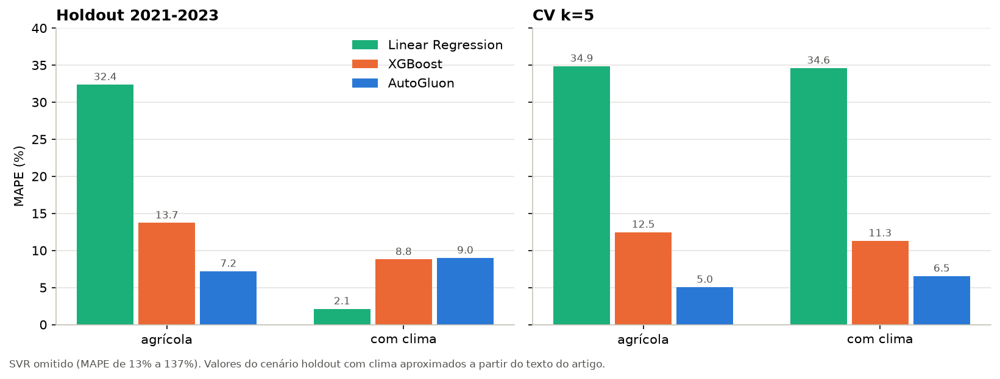
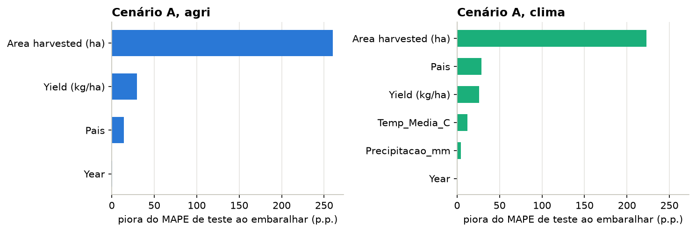
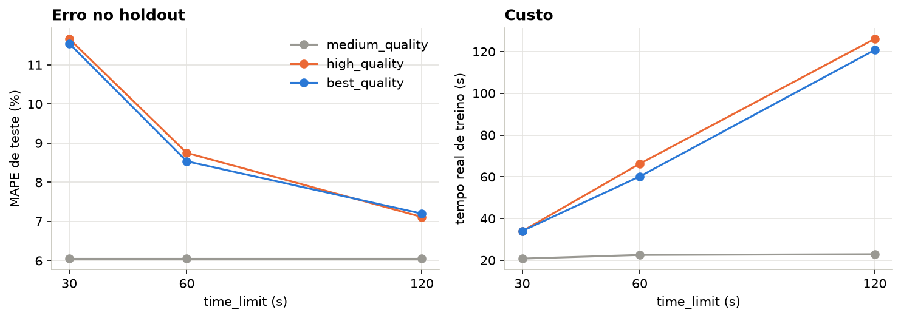
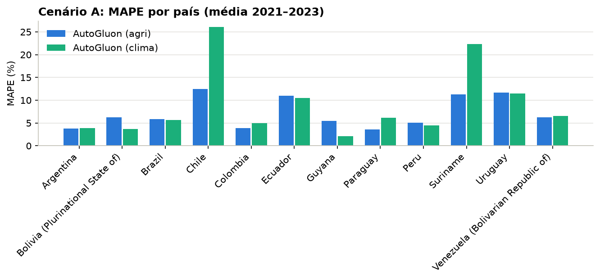
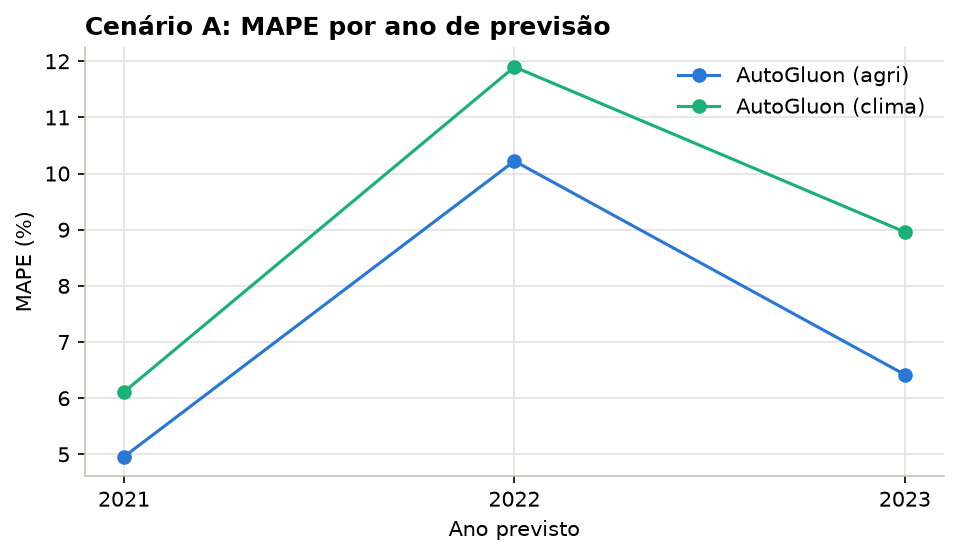

<div align="center">

# Previsão da produção de arroz na América do Sul com AutoML

### Com o AutoGluon, o erro do melhor modelo de um artigo do SBSI 2026 cai para quase a metade, e a ferramenta mostra o que escolheu e por quê.


</div>

*English summary at the end.*

| **7,2%** | **5,1%** | **3 de 4** | **± 1,1 p.p.** |
|:---:|:---:|:---:|:---:|
| MAPE no holdout 2021–2023 (XGBoost do artigo: 13,7%) | MAPE na validação cruzada (artigo: 12,5%) | cenários em que o AutoGluon supera o XGBoost do artigo | variação entre sementes, medida e reportada |

Este projeto reproduz e estende o artigo de **Grion et al. (SBSI 2026)**, *Predictive Modeling of Rice Production in South America Using Machine Learning*. O artigo prevê a produção anual de arroz de 12 países sul-americanos (2011–2023) a partir de dados agrícolas da FAOSTAT e climáticos da NASA POWER, com Regressão Linear, SVR e XGBoost ajustados à mão. Aqui, quem escolhe os modelos, os hiperparâmetros e a combinação deles é o **AutoGluon-Tabular**.



## Resultados (MAPE, menor é melhor)

| Cenário | Atributos | **AutoGluon** | XGBoost (artigo) | Regressão linear (artigo) | SVR (artigo) |
|---|---|---|---|---|---|
| Holdout 2021–2023 | agrícolas | **7,20%** | 13,72% | 32,38% | 121,15% |
| Holdout 2021–2023 | + clima | 8,99% | 8,79%* | **2,13%*** | 13,00%* |
| Validação cruzada 5-fold | agrícolas | **5,05% ± 0,48** | 12,47% | 34,87% | 137,23% |
| Validação cruzada 5-fold | + clima | **6,55% ± 1,29** | 11,30% | 34,60% | 121,00%† |

\* Valores aproximados a partir do texto do artigo, que não publica o MAPE agregado desse cenário. † O artigo diz apenas "acima de 120%".

- **O AutoGluon supera o XGBoost do artigo em três dos quatro cenários.** No holdout agrícola, o erro cai quase pela metade; na validação cruzada, para menos da metade.
- **No holdout com clima, empata com o XGBoost.** O 2,13% da Regressão Linear do artigo não se reproduz: uma Regressão Linear padronizada nos mesmos dados chega a cerca de 25%.
- **Repetindo o holdout com 3 sementes**, o MAPE fica em 7,1% ± 1,1 (agrícola) e 8,1% ± 1,1 (com clima). Diferenças menores que 1 ponto percentual não são conclusivas com 36 pontos de teste.
- **As variáveis climáticas não ajudaram.** Com só 13 anos por país, elas parecem servir mais para identificar o país do que para explicar a produção.

## Abrindo a caixa-preta

O modelo final é um **ensemble em 3 camadas** (`WeightedEnsemble_L3`). A base é um Extra Trees com bagging, que tem 56% do peso. Uma rede neural e modelos de segunda camada (Random Forest e CatBoost treinados sobre as predições da primeira) completam o ensemble. Os hiperparâmetros são os padrões da ferramenta: o ganho vem da **combinação de modelos**, não de uma busca fina.

O notebook mostra, para cada um dos ~19 modelos treinados:
- o **MAPE de validação**, que guia a escolha;
- o **MAPE de teste**, medido depois da escolha.

Essa comparação revela duas coisas. Primeiro, a validação é otimista: 4,3% contra 7,2% no teste, porque mistura anos enquanto o teste é o futuro. Segundo, a terceira camada do stacking não se pagou: o ensemble de 2 camadas foi um pouco melhor no teste, com 6,9%.

**A área colhida domina.** Embaralhá-la piora o MAPE em mais de 200 p.p. Com clima, a importância do país dobra, sem que o erro melhore.



**O preset e o tempo de treino foram escolhidos por um estudo de sensibilidade.** O `best_quality` (bagging + stacking) melhora até 120 s.
- O `medium_quality` termina em cerca de 22 s e teve um MAPE de teste menor (6,05%). Essa diferença fica dentro da variação entre sementes.
- O preset **não** foi escolhido pelo teste, porque isso usaria o teste para selecionar o modelo.



| | |
|---|---|
|  |  |

Chile, Suriname, Uruguai e Equador concentram os maiores erros. São países de produção menor ou mais variável, o mesmo padrão do artigo.

## O que tem aqui

- **Dois cenários do artigo**, sem e com clima:
  - holdout temporal, com treino em 2011–2020 e teste em 2021–2023;
  - validação cruzada 5-fold.
- **AutoGluon com `best_quality`**, otimizando diretamente o MAPE, com bagging em k-fold e stack ensembling.
- **Inspeção do processo**, para não tratar a ferramenta como caixa-preta:
  - leaderboard com o erro de validação e de teste de cada modelo;
  - pesos do ensemble e hiperparâmetros;
  - importância por permutação.
- **Sensibilidade a presets e tempo**, **variação entre sementes** e **custo computacional**. São 24 treinos, cerca de 30 min numa CPU de notebook.
- **Baseline manual** de Regressão Linear padronizada.
- **Relatório** em [`report/relatorio.pdf`](report/relatorio.pdf), com o LaTeX em `report/`.

## Como reproduzir

```bash
python3.11 -m venv .venv && source .venv/bin/activate
pip install -r requirements.txt
jupyter notebook rice_automl.ipynb       # ~30 min em CPU; modelos salvos em AutogluonModels/
cd report && latexmk -pdf relatorio.tex  # regera o relatório a partir das figuras
```

Os dados (24 KB) já estão em `data/`. Se faltarem, o notebook os baixa do [repositório do artigo](https://github.com/rgrion/mlarrozprevisao). Os resultados usam semente fixa (42), e as versões estão registradas no `requirements.txt`. No macOS, o LightGBM pode precisar de `brew install libomp`.

## Estrutura

```
├── rice_automl.ipynb       # pipeline completo, com saídas
├── data/                   # dataset FAOSTAT + NASA POWER do artigo
├── figures/                # figuras e tabela comparativa geradas pelo notebook
└── report/                 # relatório (relatorio.tex, referencias.bib, relatorio.pdf)
```

---

## English summary

This project reproduces Grion et al. (SBSI 2026) on rice production forecasting for 12 South American countries, using **AutoGluon-Tabular** (bagging plus multi-layer stacking, optimizing MAPE directly).

**Results:**
- **Temporal holdout (2021–2023), agricultural features:** AutoGluon reaches **7.2% MAPE**, against **13.7%** for the paper's tuned XGBoost.
- **5-fold cross-validation:** **5.1% and 6.6% MAPE**, against **12.5% and 11.3%**.
- **Climate holdout:** ties with XGBoost (9.0% vs 8.8%, approximate value from the paper).

**What the notebook audits:**
- the selected 3-layer ensemble (Extra Trees-based) and its weights;
- per-model validation versus test error;
- permutation importance, sensitivity to presets and time budget, and seed variance (±1.1 p.p.).

*Projeto desenvolvido na disciplina SCC0233 (Aplicações de Aprendizado de Máquina e Mineração de Dados), ICMC/USP, 2026.*
